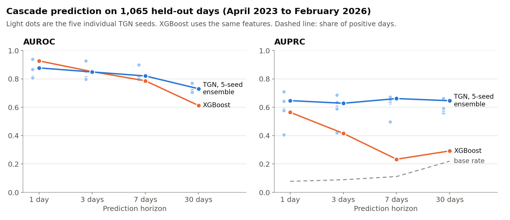

# DeFi Cascade Predictor

**A temporal graph network that treats 15 Ethereum DeFi protocols as one connected system and
scores the chance of a liquidation cascade 1, 3, 7, and 30 days ahead.**



A liquidation cascade is not one protocol failing. It is stress moving through shared
collateral, shared price oracles, liquidity routes, and governance tokens until several
protocols bleed at once. A protocol-by-protocol risk score misses that. This project
models the whole set as a graph: each protocol is a node with a memory of its own history,
each dependency is a typed edge, and the model predicts whether a cascade is coming from the
state of the system as a whole. Then it checks, with ablations, how much of that structure
actually earns its keep.

Manuscript draft: **`paper/main.tex`** (its results tables are still placeholders; the numbers
below come from the experiment outputs in `defi_cascade_predictor/outputs/`).

```
DeFiLlama daily TVL, 15 protocols, June 2021 to February 2026 (1,734 days)
    ->  46 features per protocol per day, 7 rolling channels over 30 days (322 inputs)
    ->  composability graph: shared collateral, liquidity flow, oracle, governance, liquidation path
    ->  TGN: per-protocol GRU memory + typed graph attention + attention and max pooling
    ->  four heads: cascade probability at 1, 3, 7, and 30 days
```

Score the ecosystem, not the protocol.

## The core idea

1. **Risk is relational.** Protocols that accept the same collateral, read the same oracle, or
   hold the same governance token fail together. The graph encodes this as typed, directed
   edges: 30 shared-collateral, 20 liquidity-flow, 34 oracle, 14 governance, and 24
   liquidation-pathway edges across the 15 protocols.
2. **Each protocol remembers.** A GRU memory per node carries slow deterioration (a drawdown
   building, utilization creeping up) from day to day instead of recomputing it from a window.
3. **One model, four horizons.** Separate heads for 1, 3, 7, and 30 days train jointly with a
   focal loss and horizon weights, because cascade days are rare: 7.8% of test days at the
   1-day horizon.

## What it does (measured on 1,065 held-out days, April 2023 to February 2026)

| Model | 1-day AUROC | 1-day AUPRC | 7-day AUPRC | 30-day AUPRC |
|---|---|---|---|---|
| **TGN, 5-seed ensemble** | 0.877 | **0.647** | **0.661** | **0.646** |
| TGN, single seeds (mean ± std) | 0.849 ± 0.049 | 0.585 ± 0.101 | 0.619 ± 0.063 | 0.598 ± 0.035 |
| XGBoost, same features | **0.927** | 0.564 | 0.234 | 0.292 |
| TGN, TVL features only | 0.912 | 0.470 | 0.485 | 0.471 |
| XGBoost, TVL features only | 0.871 | 0.428 | 0.181 | 0.245 |
| Share of positive days (chance AUPRC) | | 0.078 | 0.112 | 0.220 |

XGBoost ranks 1-day risk better (AUROC 0.927 against 0.877). The TGN's advantage is precision on
the rare positive days, and it widens at longer horizons: at 7 days the ensemble's AUPRC is
0.661 against 0.234 for XGBoost. Single seeds swing widely (1-day AUROC from 0.808 to 0.938), so the
ensemble is the number to quote.

Does the graph itself matter? Same model, seed 42, three different graphs:

| Graph given to the TGN | 1-day AUROC | 1-day AUPRC | 3-day AUPRC | 30-day AUPRC |
|---|---|---|---|---|
| Real composability graph | 0.818 | 0.587 | **0.603** | 0.560 |
| Random graph, same edge counts | 0.842 | 0.586 | 0.574 | **0.664** |
| Complete graph | **0.846** | 0.552 | 0.535 | 0.530 |

Not yet, on this evidence. The real graph leads only on 3-day AUPRC. Every number in both
tables is produced by `run_overnight_experiments.py`, written to `outputs/overnight_results.json`,
with the full run log (3.1 hours on CPU) in `outputs/overnight_log.txt`.

## How it works

**Data.** `fetch_real_data.py` pulls daily total value locked (TVL) from DeFiLlama with no API
key. The 15 nodes are Aave V2 and V3, Compound V2 and V3, MakerDAO, Morpho, Uniswap V2 and V3,
Curve, Balancer, Lido, Rocket Pool, Convex, Yearn, and Frax. Protocols whose DeFiLlama history
starts after June 2021 (Aave V3, Compound V3, Rocket Pool, Frax, Morpho) are zero before their
first day.

**Features.** 46 per protocol per day in six groups: TVL (8), price (9), liquidity (8), network
(6), macro (9), and calendar (6). TVL is observed. Everything else is derived from it or
reconstructed (see Honesty). Each feature is expanded into seven channels over a 30-day window
(current value, mean, standard deviation, deviation from mean, min, max, trend) for 322 inputs
per node, normalized with training-split statistics only.

**Labels.** Six named crises from `config/config.yaml` (Terra/Luna, 3AC/Celsius, FTX, USDC/SVB,
Euler, Curve) plus seven anomalies detected on aggregate TVL (daily z-score below -4.5 or a
30-day drawdown beyond 20%, lasting at least 5 days), for 13 events. A day is positive at horizon
h if a cascade starts within h, or is already under way.

**Model.** `models/tgn.py`: an input projection with a learned feature gate, a 128-dimensional
GRU memory per protocol fused with a time encoding, two layers of 4-head graph attention with one
attention module per edge type combined through learned edge-type gates, a temporal attention
step over neighbors, and attention-weighted plus max pooling across nodes. One MLP head per
horizon, plus a severity head.

**Training.** AdamW (learning rate 3e-4, weight decay 2e-4), focal loss (gamma 2.0, alpha 0.75)
with horizon weights 3, 2, 1, 1, a 0.3-weighted severity regression, and a monotonicity penalty
across horizons. Truncated backpropagation through time in 10-day windows, early stopping on
validation loss (60 epochs max, patience 18). Seeds 42, 123, 456, 789, 1337.

**Evaluation.** A chronological split: train June 2021 to October 2022 (518 days, Terra/Luna and
3AC/Celsius), validate November 2022 to March 2023 (151 days, FTX, USDC/SVB, Euler), test April
2023 to February 2026 (1,065 days, the Curve exploit plus detected anomalies). AUROC and AUPRC
per horizon.

## Run it

```bash
pip install -r defi_cascade_predictor/requirements.txt
cd defi_cascade_predictor
python fetch_real_data.py                          # DeFiLlama pull into data/real/ (not committed)
python run_overnight_experiments.py                # the four experiments behind the tables above
python main.py                                     # full pipeline: TGN, baselines, ablations, figures
python main.py --quick                             # reduced epochs
python reviewer_experiments/01_tgn_multiseed.py    # one result per script, written to outputs/reviewer_*.json
```

## Layout

```
defi_cascade_predictor/
  config/config.yaml              protocols, named cascade events, edge types, hyperparameters
  fetch_real_data.py              DeFiLlama TVL, price, yield, and volume pull
  data/collectors/                DeFiLlama, CoinGecko, FRED, BigQuery, subgraph clients; cascade labeler
  data/processing/                feature engineering, composability graph construction
  models/tgn.py                   temporal graph network
  models/layers/                  GRU memory, typed message passing, temporal attention
  models/baselines/               XGBoost, static GNN, LSTM, SIR contagion, centrality
  training/                       trainer, focal and monotonicity losses
  evaluation/                     metrics, bootstrap and Diebold-Mariano tests, ablations, plots
  experiments/run_experiments.py  real-data pipeline and full experiment runner
  main.py                         CLI for the full pipeline
  run_overnight_experiments.py    TVL-only, 5-seed ensemble, graph, and leave-one-event-out runs
  run_*.py                        other ablation and multi-seed runners
  reviewer_experiments/           seven standalone scripts, one result each
  outputs/                        overnight_results.json and logs; figures/ from an earlier synthetic run
  *.ipynb                         Colab notebooks (no saved outputs)
paper/                            manuscript draft
```

## Honesty

* Only TVL is real data. Price features are a 60/40 blend of market and protocol TVL returns,
  lending rates and utilization are derived from TVL drawdowns, on-chain activity is a TVL-velocity
  proxy, and the macro series are hand-built piecewise curves with added noise (the VIX series
  is synthetic). The TVL-only rows above show what survives without the derived features.
* Labels and features come from the same TVL series. Detected anomalies are aggregate TVL
  drawdowns, and a day counts as positive while a cascade is under way, not only before it. Part
  of what the model scores is recognizing a drawdown in progress, not forecasting one.
* The graph is not yet shown to help. A random graph with the same edge counts matches or beats
  the real one on 1-day AUROC (0.842 against 0.818) and 30-day AUPRC (0.664 against 0.560).
  Price-correlation edges are defined but empty in these runs, so five of the six edge types
  carry edges.
* Results depend on which crises the model trains on. Dropping the 3AC/Celsius training labels
  cuts 1-day test AUPRC from 0.587 to 0.130, and dropping FTX cuts it to 0.252. The training
  window holds only a few crises.
* Seed variance is large. `reviewer_experiments/07_best_seed_showcase.py` reproduces the best
  seed (789, 1-day AUROC 0.938), which overstates typical performance. The TGN trained on TVL
  features only collapses to 0.228 AUROC at 3 days, another sign of unstable training.
* The static GNN, LSTM, SIR, and centrality baselines have code but no real-data results in the
  repo. The plots in `outputs/figures/` come from an earlier synthetic-data run with 1-hour and
  6-hour horizons (`outputs/run_log.txt`) and do not match the numbers above.
* The manuscript's results tables are placeholders, and it describes a 10-day augmentation
  window (184 inputs) where the code uses 30 days (322 inputs).
* `data/real/` is not committed. Re-running `fetch_real_data.py` pulls current DeFiLlama data,
  which DeFiLlama can revise.

MIT licensed.
